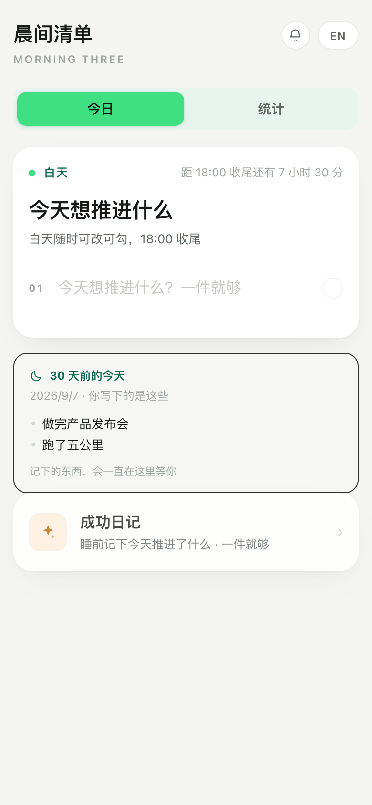
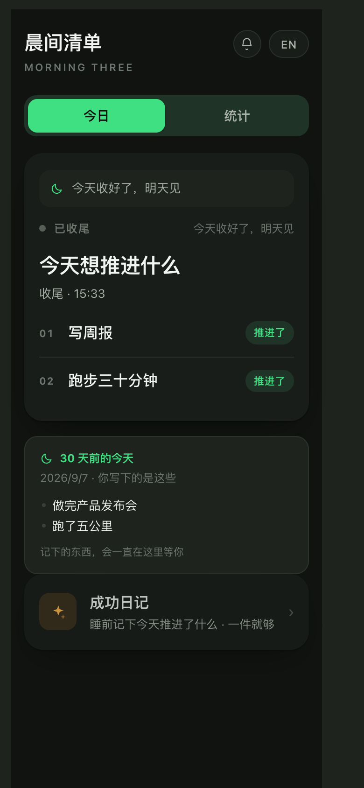

# 晨间清单 · Morning Three

早上想清楚今天要推进什么，晚上把今天收个尾。跑满一个月，解锁睡前的成功日记。

**在线试用：** https://morning-three.app.workbuddy.host/
**成功日记：** https://morning-three.app.workbuddy.host/success.html




---

## 它解决什么

你不是缺一个待办清单，你是缺一个**愿意每天打开**的地方。

大多数习惯工具用完成率、连续天数、缺席判定来驱动你。结果只有两种：为了数字好看而编，或者因为断了两天而再也不打开。这个产品把这三样全部拿掉。

## 三件事

| 时间 | 动作 | 核心设定 |
|---|---|---|
| 早上 | 写今天要推进的事 | **一件就够**，最多三件。写完一行才露出下一行，没有空格子逼你填满 |
| 白天 | 随手勾掉推进了的 | 随时可改，不判定迟到 |
| 18:00 后 | 收个尾 | 只问「推进了」，**没有「未完成」按钮**；没推进的自动带到明天 |
| 睡前 | 成功日记（满一个月解锁） | 今天推进了什么 + 状态 + 一句话；空白也能保存 |

## 四条设计原则

1. **零审判**——没有评分、没有缺席、没有补录标记。空白日也是合法数据，甚至是最有价值的数据。
2. **门槛降到可达成**——「三件要事」的上限是 3（超过就没有优先级了），下限是 1。没有要事的日子，提问降到「如果今天只能推进一件事，是哪件？」
3. **收尾不是关门**——没推进的带到明天叫「顺延」，不叫「未完成」。同一件事，两种说法，两种心理后果。
4. **回报在回看，不在当天**——On This Day、词云、一句话总结。全部只陈述，不比较、不算进步率、不说好坏。

## 睡前那屏为什么这样设计

不复盘，只观察。原本的三问（珍惜/浪费时间？进步/成长？状态差时在想什么？）是审判结构——每一问都预设一个「应该」，答不上来就是认罪。

只留了第三问，并改成**问外显不问内省**：不在状态时，你在做什么？答案「刷短视频」比「在想什么」值钱得多——它可观察、可统计，30 天后会成为模式。

而且这一问**默认不出现**，只有状态选到「疲惫」或「焦灼」时才展开。不该问的时候别问。

## 主题

- **05:00–18:00** 晨光（浅色）
- **18:00–05:00** 暗夜荧光（深色）

同一套荧光绿调性，只是底与字的明暗互换。跨过时间点自动换，不用刷新。

## 技术

- 单文件、零依赖、零 CDN、零后端
- 数据全部存在浏览器 `localStorage`，**不出本机、不上传、不登录**
- PWA：可添加到主屏幕，离线可用
- 主题靠 CSS 变量切换：`:root` 放日间值，`html.night` 覆盖夜间值

| 文件 | 说明 |
|---|---|
| `index.html` | 晨间清单（今日页 + 洞察页） |
| `success.html` | 成功日记（必须同源，localStorage 按源隔离） |
| `manifest.webmanifest` / `sw.js` | PWA 配置与离线缓存 |
| `icon-*.png` | 图标 |

## 本地运行

```bash
# 直接双击 index.html 即可，或用任意静态服务器
python3 -m http.server 8000
```

⚠️ 必须**同源**打开，`success.html` 才能读到打卡数据。

## 数据主权

没有账号，没有云端。清浏览器数据 = 清记录。这是刻意的取舍：代价是不能跨设备，换来的是不需要信任任何服务器。

## 待办 / 路线图

- [ ] 真系统推送（目前靠 iOS 快捷指令引导，纯前端的极限）
- [ ] 「星期 × 状态」热力图、月度自动总结
- [ ] 数据导出/导入（跨源搬家）
- [ ] 按新主题重做 App 图标
