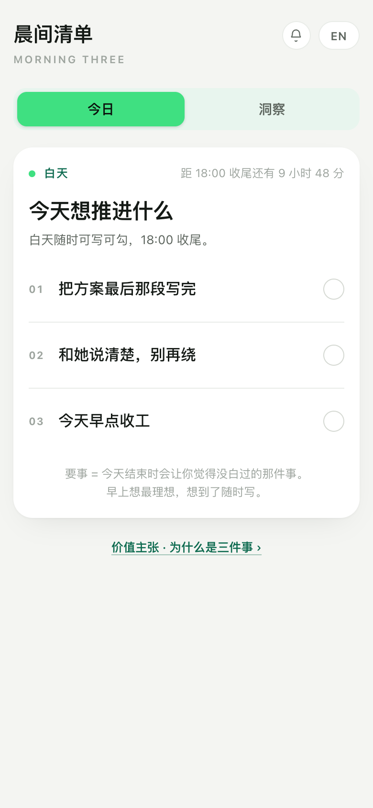
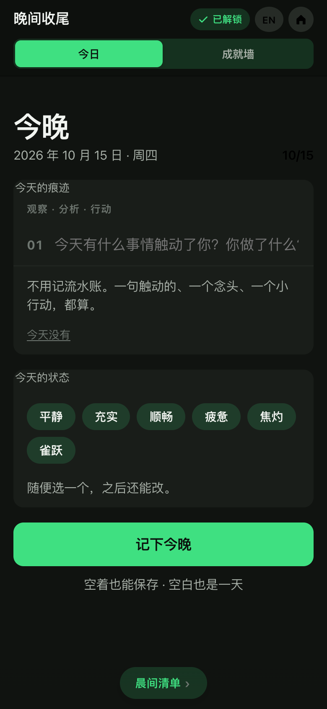

# 你不书写，世界就会覆盖你的痕记

前几天翻手机相册，翻到一年前的截图。一张聊天记录，一张外卖订单，一张深夜十一点半的日程表。我盯着那张日程表看了很久——上面密密麻麻全是别人的名字：开会、对齐、汇报、复盘。找不到一行是我自己的。

那一刻我意识到一件事：过去一年，我的每一天都被记录了，但几乎没有一天是我自己记的。

日历替我记了我要见谁，钉钉替我记了我该交付什么，外卖软件替我记了我吃了什么，微信运动替我记了我走了多少步。这些账本一本都不缺，唯独缺一本我自己的。

## 一、覆写是悄悄发生的

这个世界有一种很温和的暴力：它不删除你，它只是覆盖你。

你的时间被别人的优先级填满，你的注意力被信息流冲刷，你的情绪被热搜牵着走了一天又一天。你不是没有经历——你经历了很多——只是这些经历没有被你亲手写下来，于是它们像沙滩上的脚印，一个浪过来，就平了。

更麻烦的是，人对自己的记忆是会撒谎的。半年前那件让你整夜睡不着的事，现在想起来只剩「好像有过这么回事」。你甚至说不清自己是怎么走过来的。不是你健忘，是你从来没给记忆留下原材料。

记忆不是过去发生的事。记忆是由你的记录创造的。没被记下的那部分，等于没有发生。

所以我说：**你不书写，世界就会覆盖你的痕记。**

## 二、为什么不是目标，是三件小事

这几年所有人都被一种话语包围：目标管理、自律、自我提升、成为更好的自己。

说实话，我不太相信这套话语了。不是它错了，是它对大部分人不奏效。这个时代的人不是懒，是过载。白天被工作切碎，晚上被手机接管，你让他再给自己立一个五年目标、拆解成 OKR、每周复盘打分——这不叫成长，这叫在疲惫之上再加一层审判。

很多人的彷徨，不是不知道往哪走，是连「今天」都握不住。你跟他谈远景，他连明天上午的会都还在发怵。

所以在失控里，人需要的不是一张更大的地图，是一个很小的、今天就能握住的东西。

三件事，就够了。

不要列表，不要分类，不要优先级矩阵。就问自己一个问题：今天结束的时候，做什么事会让你觉得这一天没白过？那件事就是你的要事。写下来，哪怕只有一件。写下来了，这一天就有了一根钉子，钉在你自己的土地上。

这不是自律。这是留痕。清单关心的是「做没做完」，留痕关心的是「你还在不在」。

## 三、空白也算数

有人会问：那我没写、没做到，怎么办？

我的回答可能有点反常识：没写的那一天，是最贵的数据。

大多数工具的底层逻辑是审判——连续打卡、中断惩罚、红圈警告，它们默认你的中断是失败。可是一个真实的人，本来就会有提不起劲的日子、有只想躺着的周末、有彻底宕机的一周。把这些日子标记为「失败」，除了让你彻底放弃，没有任何用处。

空白不是缺口。空白是那天你决定不写。它和那些写得满满的日子一样，都是你。

所以我做的小东西里，没有警告，没有断签，没有红色感叹号。它站在你这边，不在你对面的法官席上。你晚了一天，它等你；你空了一周，它也等你。落笔的人才是主角，工具不配审判你。

## 四、写下困扰，就是给混乱赋予语言

还有一件事，是我自己体会最深的。

人最难受的时刻，往往不是事情本身有多糟，而是一团雾——说不清自己在烦什么、怕什么、到底哪里不对劲。情绪在身体里横冲直撞，却找不到出口。

把它写下来。不用写得好，一句话就行。写下来的那一刻，奇怪的事情发生了：那团雾有了轮廓。你在纸上看到的不再是「我很烦」，而是「我怕这个项目黄了」「我和那个人之间有一句话没说」。混乱一旦有了语言，就有了可以被处理的样子。

不需要谁来替你总结、替你分析、替你开药方。你自己就能看清。工具要做的只有一件事：把纸递给你。

## 五、长期，你安静地变了

当天写下的东西，价值其实不大。价值在回看。

写一个月，你翻回去，会看到一些反复出现的事。不是你刻意总结的，是它们自己浮上来的——也许是一个一直被你往后推的决定，也许是一段耗着你的关系，也许是你其实早就想换个活法。人这一生绕不开的主题，往往就藏在这些「又来了」里面。

再往后写，你会遇到另一种时刻：某天翻到三个月前的某一页，你愣了一下——那时候让你整夜睡不着的事，现在居然想都想不起来了。你不是咬牙挺过来的，你甚至说不出是从哪天开始好起来的。

蜕变是爽文里的情节。真实的改变安静得像水位上涨，没有哪一滴水是转折点，但你确实已经不在原来的地方了。

**长期，你安静地变了。**

它不会替你下这个结论。那个发现，得留给你自己。这才是回看最好的地方——不是工具告诉你「你进步了」，而是你在某一页纸上，亲眼看见了自己。

## 六、最后

基于这些，我做了一个很小的东西，叫「晨间三件事」。

它没有什么功能可言：早上写三件今天想推进的事，白天随时可写可勾，晚上六点之后来收个尾，写下今天触动你的一件事、选一个今天的状态。没有账号，没有社交，没有提醒轰炸，数据只存在你自己的设备里。时间长了，它会让你看见那些反复出现的事——但结论它不说，留给你。

它不想帮你成为更好的自己。它只想帮你在被世界覆写之前，留下一点自己的痕记。

手机浏览器打开就能用，不用下载：

**morning-three.app.workbuddy.host**

你不需要准备好才开始记录。你开始记录，才会看见自己。
